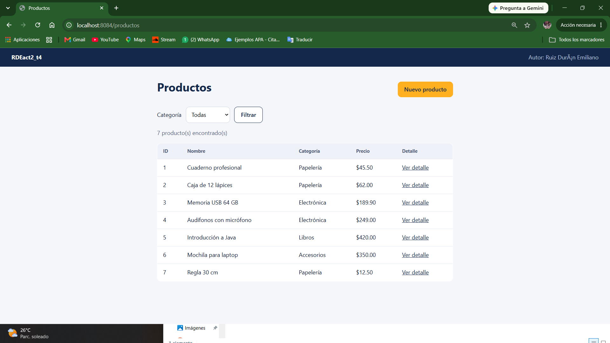
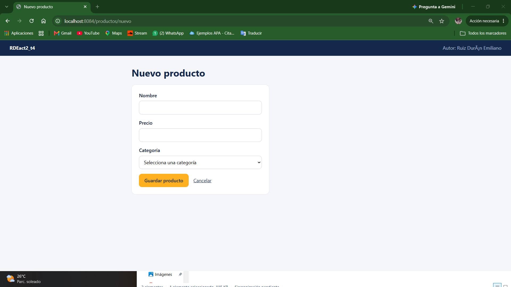
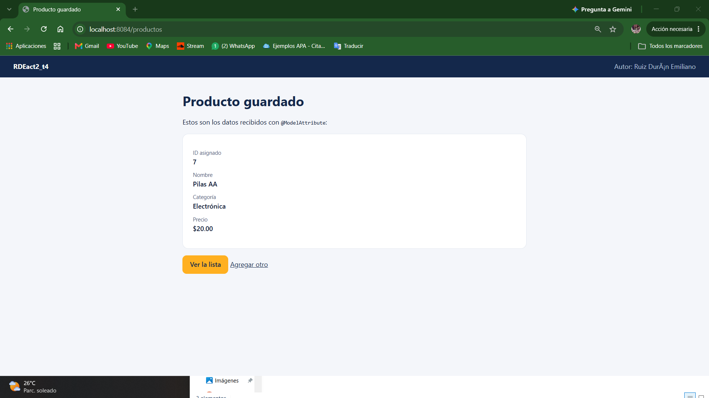
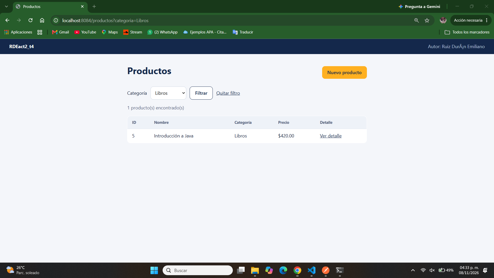
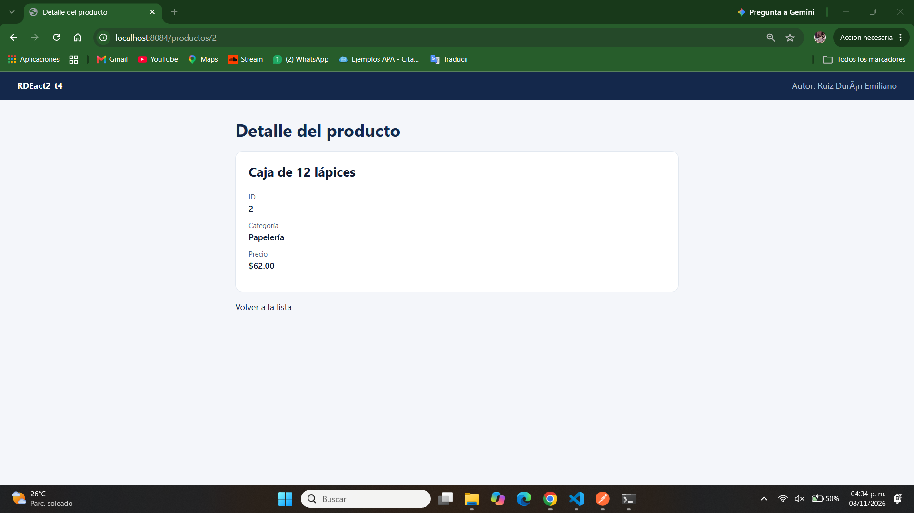
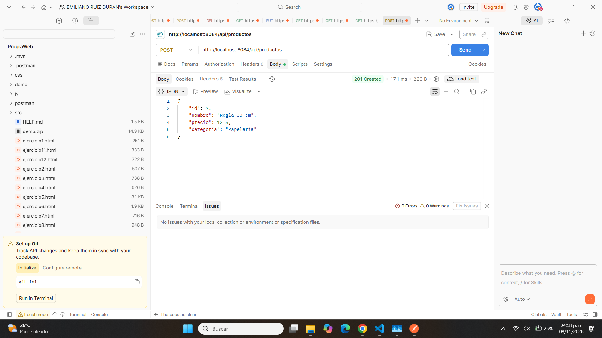

# ERDact2_t4

Segundo proyecto con **Java y Spring Boot**. Es una copia independiente del proyecto de la Actividad 1 a la que se le agregó el patrón **MVC con Thymeleaf**: vistas HTML generadas en el servidor, una clase **DTO**, el manejo de parámetros con `@ModelAttribute`, `@RequestParam` y `@PathVariable`, la lectura de propiedades con `@Value` y un endpoint **POST** que recibe y devuelve JSON, probado en Postman.

**Autor:** Ruiz Durán Emiliano

## Qué hace el proyecto

Es un pequeño catálogo de productos con dos formas de usarlo:

- **Páginas web (MVC):** lista de productos, filtro por categoría, detalle de un producto y formulario para agregar uno nuevo.
- **API REST:** lista de productos y alta de un producto enviando JSON.

Los datos viven en memoria: al reiniciar el servidor se pierden los productos agregados.

## Endpoints

| Método y ruta | Qué hace | Tema aplicado |
|---|---|---|
| `GET /productos` | Lista todos los productos | `Model`, `th:each` |
| `GET /productos?categoria=Libros` | Filtra la lista por categoría | `@RequestParam` |
| `GET /productos/{id}` | Muestra el detalle de un producto | `@PathVariable` |
| `GET /productos/nuevo` | Muestra el formulario | `th:object`, `th:field` |
| `POST /productos` | Recibe el formulario y muestra el resultado | `@ModelAttribute` |
| `GET /api/productos` | Lista los productos en JSON | `@RestController` |
| `POST /api/productos` | Recibe un producto en JSON y lo devuelve con su id | `@RequestBody` |
| `GET /api/proyecto`, `/api/perfil`, `/api/materias`, `/api/saludo/{nombre}`, `/api/suma` | Endpoints de la Actividad 1 (se conservan) | `@RestController` |

## Arquitectura MVC

```
Navegador  ->  Controlador  ->  Modelo (DTO y servicio)
                    |
                    v
                  Vista (plantilla Thymeleaf)  ->  HTML para el navegador
```

| Parte | Qué es en este proyecto |
|---|---|
| **Modelo** | `ProductoDTO` (los datos) y `ProductoService` (la lista en memoria y su lógica) |
| **Vista** | Plantillas Thymeleaf en `templates/`: `productos.html`, `producto-detalle.html`, `producto-form.html` y `producto-resultado.html` |
| **Controlador** | `ProductoViewController`: recibe la petición, pide los datos al servicio, los guarda en el `Model` y devuelve el nombre de la vista |

El controlador REST (`ProductoRestController`) no usa vistas: responde directamente JSON.

## Estructura del proyecto

```
src/main
├── java/com/example/demo
│   ├── DemoApplication.java
│   ├── controller
│   │   ├── ProyectoController.java         (Actividad 1)
│   │   ├── PerfilController.java           (Actividad 1)
│   │   ├── ProductoViewController.java     (MVC, devuelve vistas)
│   │   └── ProductoRestController.java     (REST, devuelve JSON)
│   ├── dto
│   │   └── ProductoDTO.java
│   ├── model                               (Actividad 1)
│   └── service
│       └── ProductoService.java
└── resources
    ├── application.properties
    ├── static/css/estilos.css
    └── templates
        ├── productos.html
        ├── producto-detalle.html
        ├── producto-form.html
        └── producto-resultado.html
```

## Tecnologías y entorno

| Herramienta | Versión |
|---|---|
| Java (JDK Eclipse Temurin) | 21 |
| Spring Boot | 4.1.2 (Spring Web y Thymeleaf) |
| Maven | con Maven Wrapper `mvnw` |
| Servidor | VPS de Vultr con Ubuntu |

## Cómo se realizó

### 1. Duplicar el proyecto anterior

1. Se copió la carpeta completa del proyecto de la Actividad 1 a una carpeta nueva, sin modificar la original.
2. En la copia se borró la carpeta oculta `.git` (y `target`), para no mezclar los historiales, y se ejecutó `git init`.
3. Se creó un repositorio nuevo, `RDEact2_t4`, y se subió ahí la copia. El repositorio de la Actividad 1 sigue intacto.

### 2. Agregar Thymeleaf

En el `pom.xml` se añadió la dependencia:

```xml
<dependency>
    <groupId>org.springframework.boot</groupId>
    <artifactId>spring-boot-starter-thymeleaf</artifactId>
</dependency>
```

### 3. Crear el DTO y el servicio

- `ProductoDTO` es una clase con `id`, `nombre`, `precio` y `categoria`, con sus getters y setters y un constructor vacío (Spring lo necesita para llenar el objeto con los datos del formulario).
- `ProductoService` guarda seis productos de ejemplo en una lista en memoria y ofrece los métodos `listar`, `listarPorCategoria`, `buscarPorId`, `agregar` y `categorias`.

### 4. Crear el controlador MVC

`ProductoViewController` está anotado con `@Controller` y `@RequestMapping("/productos")`. Sus métodos devuelven el nombre de una vista:

- `listar`: usa `@RequestParam` para filtrar por categoría, llena el `Model` y devuelve `productos`.
- `detalle`: usa `@PathVariable("id")` para buscar un producto y devuelve `producto-detalle`.
- `nuevo`: envía un `ProductoDTO` vacío al formulario.
- `guardar`: recibe el formulario con `@ModelAttribute`, guarda el producto y devuelve `producto-resultado`.

### 5. Crear las vistas con Thymeleaf

Las plantillas usan estas directivas:

| Directiva | Dónde se usa |
|---|---|
| `th:each` | Recorre la lista de productos en la tabla y las categorías en los selectores |
| `th:text` | Muestra los valores del modelo |
| `th:if` / `th:unless` | Muestra mensajes según haya o no resultados |
| `th:href` / `th:action` | Construyen las rutas, por ejemplo `@{/productos/{id}(id=${p.id})}` |
| `th:object` / `th:field` | Enlazan el formulario con el `ProductoDTO` |
| `th:selected` | Deja marcada la categoría elegida en el filtro |

### 6. Leer una propiedad con `@Value`

En `application.properties` se definieron `app.nombre-proyecto` y `app.autor`. El controlador las lee con `@Value` y las manda al `Model`, y todas las vistas las muestran en el encabezado.

### 7. Crear el endpoint POST de tipo REST

`ProductoRestController` usa `@RestController` y `@RequestBody` para recibir un `ProductoDTO` en JSON, y responde `201 Created` con el producto y su id. Se probó en Postman:

- **Petición:** `POST http://localhost:8080/api/productos`, en *Body*, *raw*, *JSON*:
```json
{"nombre": "Regla 30 cm", "precio": 12.5, "categoria": "Papelería"}
```
- **Respuesta (201 Created):**
```json
{"id": 7, "nombre": "Regla 30 cm", "precio": 12.5, "categoria": "Papelería"}
```

### 8. Compilar y desplegar en el VPS

1. `.\mvnw.cmd clean package` genera `target/demo-0.0.1-SNAPSHOT.jar`.
2. Se creó una carpeta nueva en el servidor, distinta a la de la Actividad 1: `mkdir -p ~/act2`.
3. Se abrió un puerto distinto con `ufw allow 8084/tcp` y se subió el jar con `scp` a esa carpeta.
4. Se ejecutó con `nohup`, dejando corriendo también la Actividad 1:
```bash
cd ~/act2
nohup java -jar demo-0.0.1-SNAPSHOT.jar --server.port=8084 > app.log 2>&1 &
```
5. Se comprobó que ambas actividades respondan al mismo tiempo, cada una en su puerto.

## Capturas de pantalla

**Lista con `th:each`** (`/productos`)



**Formulario con `@ModelAttribute`** (`/productos/nuevo`) y su resultado





**Filtro con `@RequestParam`** (`/productos?categoria=Libros`)



**Detalle con `@PathVariable`** (`/productos/2`)



**Petición POST en Postman** (`POST /api/productos`)



## Cómo ejecutarlo

Requisitos: JDK 21 o superior.

```bash
.\mvnw.cmd spring-boot:run
```

En Linux o Mac: `./mvnw spring-boot:run`. Se abre en http://localhost:8084/productos

## Problemas encontrados y cómo se resolvieron

| Problema | Causa | Solución |
|---|---|---|
| Los `push` iban al repositorio de la Actividad 1 | La copia del proyecto traía la carpeta `.git` original | Se borró `.git` en la copia y se hizo `git init` |
| Las dos actividades no pueden usar el mismo puerto | Un puerto solo lo escucha un proceso | La Actividad 2 corre en otro puerto, con su propia carpeta |
| Se detiene la actividad equivocada | `pkill java` mata todos los procesos Java | Se usa `pkill -f "server.port=[PUERTO]"` |

## Enlaces

- Repositorio de esta actividad: https://github.com/23161115-estud/ERDact2_t4
- Proyecto en el VPS (Actividad 2): http://216.238.69.86:8084/productos
- Actividad 1 (sigue corriendo en su puerto original): http://216.238.69.86:8082/api/proyecto
- Repositorio de la Actividad 1: https://github.com/23161115-estud/ERDact1_t4-.git
